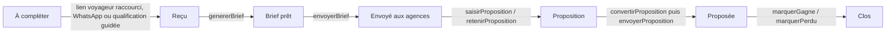
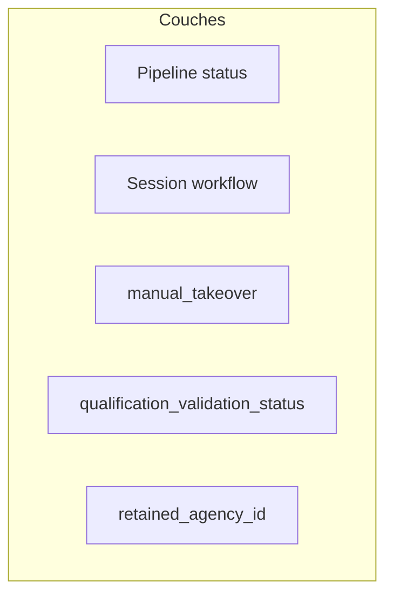
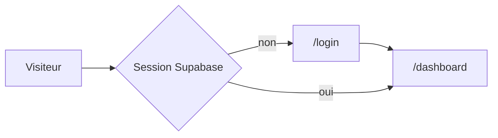
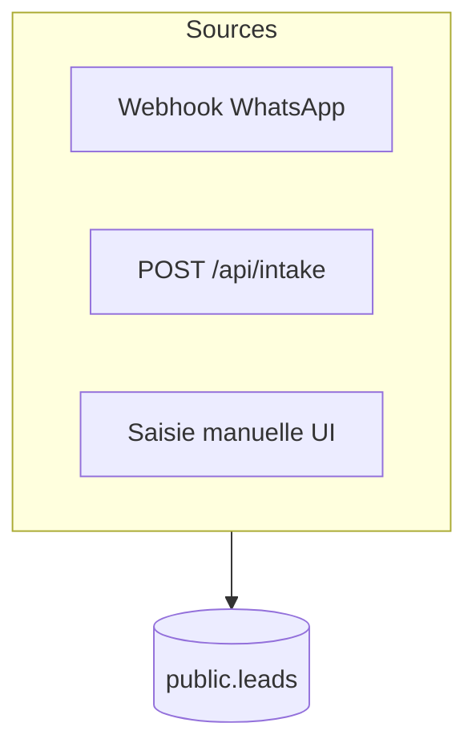
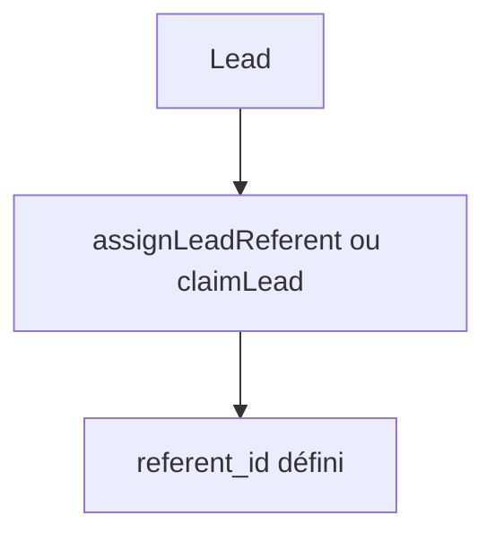
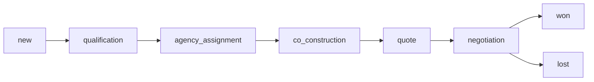
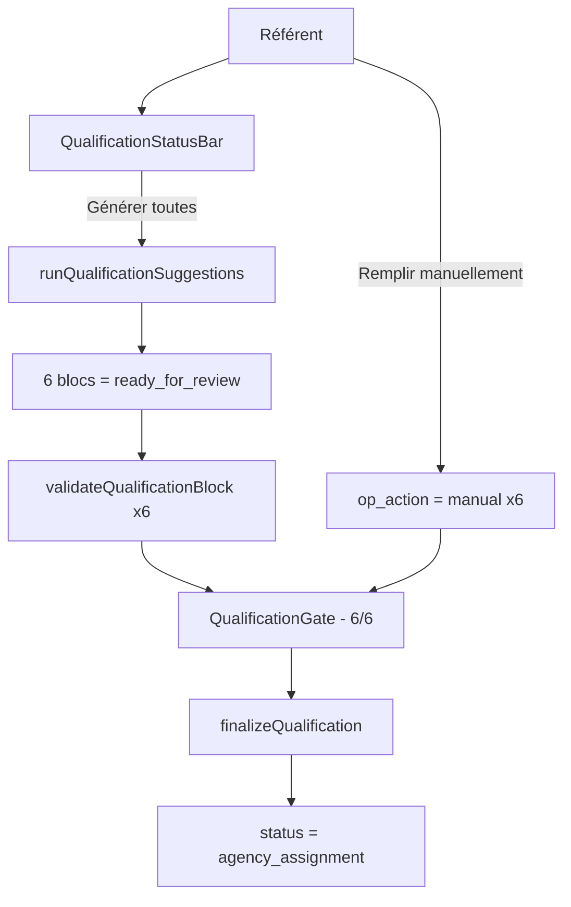

# Parcours utilisateur, pipeline et garde-fous (doc vivante)

| Champ | Valeur |
|-------|--------|
| **Périmètre** | Cockpit lead (`/leads/[id]`), liste leads, workflow voyageur (`/leads/[id]/workflow`), statuts pipeline Supabase, gates brief, intake, webhooks ; effets **côté opérateur** des politiques RLS. |
| **Dernière revue** | 2026-09-27 — Back office v3 : parcours piloté par la trame du site, 7 étapes affichées, deux horloges de 48 h, proposition Direction l'Algérie. Voir la section « Parcours v3 » ci-dessous et [`REFONTE_V3.md`](./REFONTE_V3.md). Les sections v2 plus bas décrivent les écrans conservés sous `/leads/[id]/workflow` (redirigé) et `/agencies/gestion`. |
| **Sources de vérité** | Runtime : code dans `src/app/(dashboard)/leads/actions.ts`, `workflow-actions.ts`, `lead-brief-gate.ts`. Spec produit : [`PRODUCT_SPEC.md`](./PRODUCT_SPEC.md). |

## Parcours v3 — de la trame du site au dossier gagné (depuis le 27/09/2026)

Le voyageur compose son voyage sur www (Composer, « Mon projet ») ; le site envoie une **trame** structurée à `POST /api/intake`. Le back office part de cette trame au lieu de la requalifier. Détail des données : [`REFONTE_V3.md`](./REFONTE_V3.md).

- **Étapes affichées** : dérivées de `leads.status` et du contenu du dossier (`statutDe()` dans `src/lib/bo3/load.ts`). L'enum de la base ne change pas.
- **Première réponse sous 48 h** : `premiereReponse` ou `demanderManque` (le lien voyageur vaut première réponse). L'accusé de réception automatique (`TRAVELER_ACK_ENABLED`) ne compte pas comme première réponse.
- **Garde-fou « Reçu → Brief prêt »** : la trame doit contenir dates, groupe, budget et lieux (`manqueDe()`), sinon le dossier reste « À compléter ». Le budget peut être « À définir avec l'agence ».
- **Brief anonyme** : `envoyerBrief` refuse l'envoi si le brief contient le prénom, le nom complet, l'e-mail ou le téléphone du voyageur (`fuitesBrief()`).
- **Réponse agence sous 48 h** : horloge par agence depuis `brief_sent_at` ; accusé, relances et refus sont datés.
- **Proposition Direction l'Algérie** : le devis d'une agence est converti (titre, lignes, prix par personne, validité, mention du partenariat), puis envoyé au voyageur. Le voyageur ne reçoit jamais le devis de l'agence tel quel.
- **Écritures** : les actions de `projet-actions.ts` écrivent le statut directement, **conditionné au statut de départ** (jamais de retour en arrière). Elles ne passent pas par `updateLeadStatus` / `assertLeadStatusTransition`. La RLS s'applique toujours : un dossier sans référent est pris par l'opérateur qui agit (`prendreDossier`).

## Carte des zones code (à re-vérifier quand le flux change)

- `src/app/(dashboard)/leads/actions.ts` — pipeline, référent, gates
- `src/app/(dashboard)/leads/workflow-actions.ts` — session workflow, reset
- `src/app/(dashboard)/leads/ai-actions.ts` — IA, `manual_takeover`
- `src/lib/lead-brief-gate.ts` — brief exploitable, qualification sign-off
- `src/components/leads/lead-cockpit-shell.tsx`, `lead-cockpit-pipeline.tsx`, `lead-cockpit-bottom-nav.tsx`
- `src/app/api/intake/`, `src/app/api/whatsapp/webhook/`
- `supabase/migrations/`, [`RLS_PROD_CHECKLIST.md`](./RLS_PROD_CHECKLIST.md)

---

## Modèle d’état multi-couches

Un dossier combine plusieurs dimensions qui évoluent **indépendamment** dans la base :

1. **Statut pipeline** — `leads.status` (`new` → … → `won` / `lost`).
2. **Session workflow voyageur** — `workflow_launched_at`, `workflow_mode`, `workflow_run_ref`, `workflow_launched_by`.
3. **Reprise manuelle IA** — `manual_takeover`.
4. **Validation qualification** — `qualification_validation_status`.
5. **Agence retenue** — `retained_agency_id` (après assignation).

---

## Parcours : authentification

---

## Parcours : entrée d’un lead

---

## Parcours : référent (opérateur travel desk)

- **Allouer** : `assignLeadReferent` ; **prendre** : `claimLead`.
- Tant que `referent_id` est vide, le passage hors `new` est bloqué (`assertLeadStatusTransition`).

---

## Parcours : pipeline linéaire (intention produit)

Ordre : `LEAD_PIPELINE` dans `src/lib/mock-leads.ts`.

### Vérité serveur : `updateLeadStatus` vs `moveLeadPipelineStep`

- **`moveLeadPipelineStep`** : avance ou recule **d’une seule** étape — aligné avec le parcours linéaire.
- **`updateLeadStatus`** : accepte un statut cible **quelconque** tant que les garde-fous passent — d’où l’écart historique avec les schémas (voir conflit **C1** et correctif dans [`CODE_PATCHES_P0_FROM_PLAN.md`](./CODE_PATCHES_P0_FROM_PLAN.md)).

---

## Parcours : qualification v2 — 6 blocs thématiques

> **v2 (2026-05-01)** — Remplace le workspace v1 (champs libres + statut global). Composant : `src/components/leads/qualification/lead-qualification-workspace.tsx`.

### 6 blocs structurés

| Bloc | Description | Sections |
|------|-------------|----------|
| `vibes` | Ambiance & type de voyage | expériences, rythme, structure |
| `group` | Composition du groupe | taille, profil, niveau physique |
| `timing` | Temporalité | durée, saison, flexibilité |
| `stay` | Hébergement | type, confort |
| `highlights` | Incontournables & contraintes | must-see, évitements, contraintes |
| `budget` | Budget | fourchette, valeur, inclusions |

### 4 états d'un bloc

| État (`ai_status` / `op_action`) | Affichage |
|----------------------------------|-----------|
| `pending` + `op_action=null` | En attente (gris) — boutons "Suggestions IA" ou "Remplir manuellement" |
| `in_progress` + `op_action=null` | IA en cours (ambre, spinner) |
| `ready_for_review` + `op_action=null` | Prêt à valider (bleu) — chips IA affichées, actions Confirmer/Ajuster/Manuel |
| tout + `op_action!=null` | Validé (vert) — chips figées, bouton "Modifier" |

### Actions disponibles (v2)

| Action | Server action | Effet |
|--------|--------------|-------|
| Générer suggestions | `runQualificationSuggestions` | OpenAI → suggestions chips par bloc, confiance, sections manquantes |
| Valider un bloc | `validateQualificationBlock` | `op_action = confirmed/adjusted/manual` + `op_validated_at` |
| Mettre à jour sélections | `updateBlockSelections` | Sélections intermédiaires sans validation |
| Rouvrir un bloc | `reopenQualificationBlock` | Reset `op_action=null`, conserve sélections |
| Valider la qualification | `finalizeQualification` | Vérifie 6 blocs validés → `status = agency_assignment` |

**Variable d'env requise :** `OPENAI_API_KEY` (server-only).

### Lancement workflow (inchangé v1)

- `launchWorkflowAi` / `launchWorkflowManual` (`workflow-actions.ts`) ; seul le **référent** du dossier.
- **Reset session** : `resetWorkflowVoyageurSession`.

---

## Parcours : gate « brief prêt » → assignation agence

- **v2** : `isLeadBriefExploitable` retourne `allBlocksValidated(lead.qualification_blocks)`. Tous les 6 blocs doivent avoir `op_action !== null`.
- **Fallback v1** : si `qualification_blocks` est absent (leads legacy), la gate utilise la checklist 8-champs + `qualification_validation_status`.
- Implémentation : `isLeadBriefExploitable` / `getBriefGateBlockMessage` (`lead-brief-gate.ts`) + `assertBriefExploitableBeforeAgencyAssignment` (`actions.ts`) sur `qualification` → `agency_assignment`.

---

## Parcours : après assignation agence

- `retained_agency_id` requis avant d’aller au-delà de `agency_assignment` (`assertLeadStatusTransition`).
- Sortie de `co_construction` vers `quote` : proposition approuvée liée à un devis ou devis existant (`assertCoConstructionApprovedIfLeaving`).

---

## Conflits connus (C1–C8)

| ID | Sujet | Mitigation / correctif |
|----|--------|-------------------------|
| C1 | Sauts d’étape via `updateLeadStatus` | Adjacent strict hors admin — voir patch doc |
| C2 | Session workflow alors que le statut a quitté `qualification` | Nettoyer champs session à la sortie de `qualification` — voir patch doc |
| C3 | Changement de référent vs session | Clear session à la réassignation — voir patch doc |
| C4 | `manual_takeover` vs tâches async | Matrice à documenter par audit code ; respect takeover sur chaque écriture |
| C5 | Brief gate / mode manuel / hybride | Copie UX + règles dans `lead-brief-gate.ts` |
| C6 | Reset session et `manual_takeover` | Déjà aligné dans `resetWorkflowVoyageurSession` (`manual_takeover: false`) |
| C7 | Doc vs code (`triggerQualificationConversation`) | Voir [`IMPLEMENTATION_PENDING_V2.md`](./IMPLEMENTATION_PENDING_V2.md) |
| C8 | RLS vs Server Actions | [`RLS_PROD_CHECKLIST.md`](./RLS_PROD_CHECKLIST.md) |

---

## Changelog parcours (récent)

| Date | Changement |
|------|------------|
| 2026-04-20 | Création de ce document ; correctifs P0 mergés dans le code (`actions.ts`, cockpit pipeline, `lead-supabase-pipeline`). |
| 2026-04-20 | Refonte UI/UX complète : inbox, cockpit 3 colonnes, dashboard pilotage, liste leads. |
| 2026-04-20 | Workspace qualification unifié : `LeadQualificationWorkspace` + agent Claude Haiku + 3 server actions. Migration `destination_main`, `travel_desire_narrative`, `qualification_notes`. |
| 2026-04-21 | Back Office v2 : fix sidebar sticky (layout), sparklines + top agencies réels dans Pilotage business, module Gestion agences v1 (CRUD, contacts, logos, détail 5 sections). |
| 2026-09-27 | Back office v3 : file de travail `/inbox`, fiche projet `/leads/[id]` pilotée par la trame, 7 étapes affichées, horloges 48 h voyageur et agence, brief anonyme, proposition Direction l'Algérie (PDF v3), lien voyageur raccourci `/q/<token>?champs=`. `/metrics` → `/dashboard`, `/leads/[id]/workflow` → `/leads/[id]`, ancienne liste des agences sous `/agencies/gestion`. Suppression du déclencheur en double `leads_sync_contact`, qui empêchait tout passage en gagné ou perdu. |

---

---

## Parcours admin — Gestion des agences

### Créer une agence
1. `/agencies` → bouton "Nouvelle agence" → drawer s’ouvre
2. Remplir : raison sociale (obligatoire), type, pays, ville (obligatoires), contact principal (obligatoire en création)
3. Submit → `createPartnerAgency()` → agence créée en `pending_validation`
4. Apparaît dans la grille ; clic → `/agencies/[id]`

### Modifier une agence
1. `/agencies/[id]` → bouton "Modifier" → drawer pré-rempli
2. Modification → `updateAgency()` — champs contacts non modifiés via ce drawer (utiliser section Contacts)
3. Changement de statut via menu kebab → `updateAgencyStatus()`

### Gérer les contacts
1. Section "Contacts" de la fiche → bouton "+ Ajouter un contact"
2. `addAgencyContact()` — le premier contact créé n’est pas automatiquement primaire
3. "Définir comme principal" → `setPrimaryAgencyContact()` — reset l’ancien primary puis set le nouveau (deux updates, service role)
4. Impossible de supprimer le contact principal sans en nommer un autre d’abord

### Supprimer une agence
**Guard de suppression (sans force) :**
- Si l’agence a des leads avec `retained_agency_id` actifs (statut ≠ won/lost) → bloqué
- Si l’agence a des consultations non terminées (≠ declined/quote_received) → bloqué
- `deleteAgency(id)` retourne `{ blocked: true, activeLeads: N, activeConsultations: M }`
- Le dialog affiche le détail d’impact, propose "Annuler" ou "Détacher et supprimer quand même"

**Force delete (admin) :**
- `deleteAgency(id, { force: true })` :
  1. Détache `retained_agency_id = null` sur les leads actifs
  2. Log `activities.kind = ‘agency_removed’` sur chaque lead impacté
  3. Archive les consultations actives → status `declined`
  4. Supprime l’agence

**RLS :** mutations sur `agencies` et `agency_contacts` réservées aux admins (`is_app_admin()`). Les référents peuvent voir les agences mais pas les modifier.

### Conflits agences (CA1–CA3)

| ID | Sujet | Mitigation |
|----|-------|------------|
| CA1 | Suppression agence avec leads actifs | Guard bloquant + force delete explicite |
| CA2 | Deux contacts `is_primary = true` | Unique index partiel `agency_contacts_primary_unique` |
| CA3 | Logo upload concurrent (2 onglets) | Dernière écriture gagne — acceptable |

---

## Parcours — Lien voyageur & requalification (`/q/<token>`)

Alternative à la qualification par email long : une page publique où le voyageur complète son projet.

1. **Génération** (opérateur, cockpit → dossier) : bouton « Lien voyageur » → `generateTravelerLink(leadId)` alloue `public_token` (uuid, 30 j) et retourne `https://app.directionlalgerie.com/q/<token>`. L'opérateur le colle dans son email au client (envoi manuel, boîte DA).
2. **Complétion** (voyageur) : `/q/<token>` (mobile-first, hors auth) affiche la synthèse du projet (jamais email/téléphone) + 6 sections → `POST /api/q/<token>` écrit `traveler_responses` (JSONB) + `traveler_responses_submitted_at`.
3. **Lecture** (opérateur) : panneau « Réponses voyageur » (lecture seule) dans le dossier. Pas d'auto-application aux blocs `qualification_blocks` en v1.

**Variante v3, lien raccourci** : `demanderManque` produit `/q/<token>?champs=dates,groupe,budget,lieux` limité à ce qui manque à la trame. La page affiche alors un formulaire court, posté sur `POST /api/q/<token>/champs`, qui complète `ai_qualification_payload.trame_v3` et ajoute une activité `traveler_answers` au fil du dossier. Sans `champs`, le questionnaire long ci-dessus reste en place.

Règles : soumission **unique** (`409` si déjà soumis) ; **régénérer** le lien réouvre la soumission (`submitted_at → null`) en conservant les réponses comme pré-remplissage ; token invalide/expiré → page « lien expiré » sans fuite d'info. Service role uniquement (page RSC + route API) ; le middleware ne rafraîchit pas la session sur `/q/*`. Colonnes ajoutées au lead via une requête isolée (tolère l'absence de migration). Spec complète : [`SPEC_PAGE_VOYAGEUR_REQUALIFICATION.md`](./SPEC_PAGE_VOYAGEUR_REQUALIFICATION.md).

---

## Avancement manuel des dossiers — 31 octobre 2026

La fiche BO3 propose **Avancer manuellement**, sous les étapes et dans **Actions**, pour déclarer un traitement déjà effectué sur WhatsApp, par e-mail, au téléphone ou par un autre canal. L’opérateur choisit une étape ultérieure jusqu’à « Proposée au voyageur » et renseigne une note obligatoire. Il peut sauter plusieurs étapes déjà traitées hors du desk. La clôture garde les actions explicites « Marquer gagné » et « Clore · perdu » (motif obligatoire).

`avancerEtapeManuellement` relit le dossier et contrôle le rôle, le référent, la progression et la version affichée. La fonction SQL `advance_lead_manual_stage` (migration `20261031120000`) verrouille le dossier, recontrôle les accès et la version, puis enregistre le statut et l’activité `manual_stage_advanced` dans une seule transaction. Un dossier libre est pris en charge par l’opérateur ; un dossier archivé, clos, modifié entre-temps ou affecté à un autre référent est refusé (sauf admin pour l’affectation).

Le jalon manuel complète le calcul des étapes BO3 et apparaît dans **Voyageur & messages**, avec auteur en base, date, étape, canal et note. Il ne fabrique ni email, ni brief, ni consultation, ni devis, et ne remplit pas les informations de qualification manquantes. Les contrôles de complétude et d’anonymisation des vrais envois restent actifs. Une clôture, une remise à zéro du dossier et une progression ultérieure du pipeline priment sur l’ancien jalon. Les jalons antérieurs au dernier `lead_reset` restent dans l’historique et ne comptent plus pour le nouveau cycle de traitement. Les notifications habituelles de statut du projet suivent le statut enregistré.

La case facultative **La première réponse au voyageur a déjà été faite** ajoute un jalon `first_response` dans la même transaction, uniquement si aucune première réponse n’est connue. Elle arrête le compteur des 48 h à la date de l’enregistrement ; une première réponse existante conserve sa date. La déclaration ne contacte pas elle-même le voyageur.

## Premier contact et modes de communication — 31 octobre 2026

Le premier échange est indépendant de la qualification. **Échange déjà effectué** permet de déclarer un contact par WhatsApp, e-mail, téléphone ou autre voie, avec un résumé et sa date réelle (heure d’Alger). La case de première réponse arrête le compteur des 48 h à cette date ; l’étape et les informations de qualification restent inchangées. La déclaration est enregistrée atomiquement, avec auteur, version du dossier et contrôle du référent ou de l’administrateur. Un dossier clos ou archivé est refusé.

**Préparer un email** ouvre un modèle relisible et modifiable. L’opérateur peut l’envoyer depuis le desk avec Resend, le copier puis déclarer son envoi par ses propres moyens, ou enregistrer l’échange WhatsApp/téléphone séparément. Préparer, enregistrer un brouillon, copier du texte ou créer un lien voyageur ne constitue pas un envoi et n’arrête pas le compteur. Les emails welcome/qualification réellement envoyés ou déclarés externes comptent comme premier contact, sans déclarer la qualification terminée.

Les consultations agence restent en brouillon jusqu’à l’envoi réel ou déclaré. Les brouillons sont recherchés directement par leur action de préparation et sont exclus des consultations envoyées, des horloges, de l’historique des briefs envoyés et des indicateurs globaux. Le périmètre du routage (portion ou voyage entier) est calculé côté serveur, stocké et repris dans le modèle, y compris après régénération. Un brouillon déjà préparé avec un périmètre différent doit être repris dans ce même mode.

Les envois ou nouvelles déclarations d’envoi sont refusés après clôture, côté serveur et par un trigger SQL pour les appels directs. Une confirmation prestataire déjà en cours peut encore finaliser son journal après clôture ; les règles existantes d’archivage et de RLS restent applicables. La migration additive 20261031180000_lead_external_exchange.sql contient ce contrôle et la fonction de déclaration d’un échange. Les six migrations mailing historiques déjà appliquées en production sont aussi présentes dans les sources.

L’en-tête de la fiche possède une couche explicite au-dessus des cartes animées pour que le menu Actions soit entièrement visible et cliquable. Les emails se chargent dans une fenêtre large, avec aperçu et choix du mode d’envoi.

## Règle d’évolution (obligatoire)

Toute PR qui modifie **pipeline**, **workflow voyageur**, **gates brief**, **référent**, **intake** ou **RLS** sur les leads doit **mettre à jour ce fichier** (diagrammes, tableau C1–C8, ou changelog) dans la **même PR**, sauf urgence avec PR de suivi sous 48 h et todo explicite.

Voir aussi [`CONTRIBUTING.md`](../CONTRIBUTING.md).
